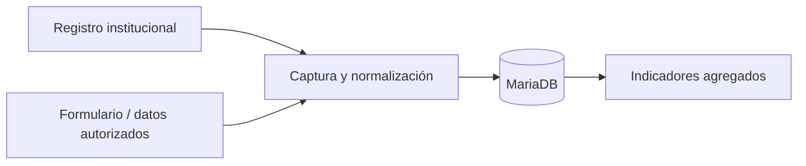
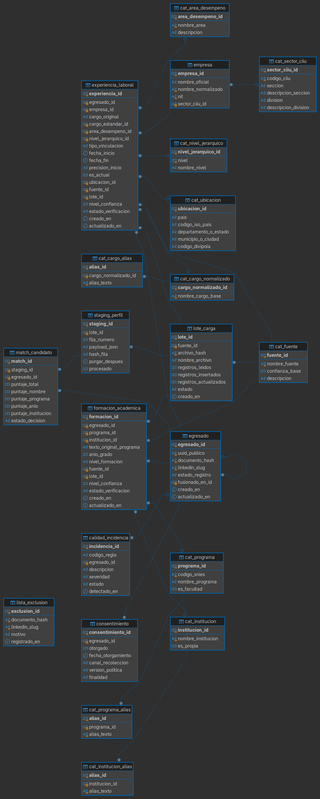

# 🎓 Seguimiento de egresados · Facultad de Ingeniería

> Propuesta metodológica y modelo de datos para conocer la trayectoria académica y laboral de los egresados de forma **trazable, repetible y respetuosa de los datos personales**.

Presentado por **Juliana Parra Caro**




## Qué incluye

| Pieza | Propósito |
| --- | --- |
| 📖 [Documento metodológico](documentos/documento_metodologico.md) | Alcance, flujo operativo, calidad, privacidad e indicadores. |
| 🗄️ [Esquema SQL](db/egresados_ingenieria.sql) | Base MariaDB con catálogos, datos de prueba, relaciones y controles. |
| 🧩 [Diagrama entidad–relación](diagramas/egresados_ingenieria.png) | Vista completa del modelo de datos. |
| 🖼️ `db/*.png` | Referencias visuales de tablas clave. |

## Estructura

```text
.
├── documentos/
│   └── documento_metodologico.md   # Proceso y decisiones de diseño
├── diagramas/
│   └── egresados_ingenieria.png    # Diagrama de la base de datos
└── db/
    ├── egresados_ingenieria.sql    # Esquema + datos ficticios de prueba
    └── tabla_*.png                 # Tablas principales documentadas
```

## Modelo, en breve

El núcleo relaciona a cada **egresado** con su **formación académica** y sus **experiencias laborales**. Catálogos normalizan programas, cargos, sectores, áreas y ubicaciones; las tablas de lote, fuente, coincidencias, consentimiento y calidad conservan la historia de cada dato.



---

**Nota:** los registros incluidos son ficticios. La propuesta evita la extracción automática de perfiles de LinkedIn y plantea usar datos aportados o autorizados por los egresados.
