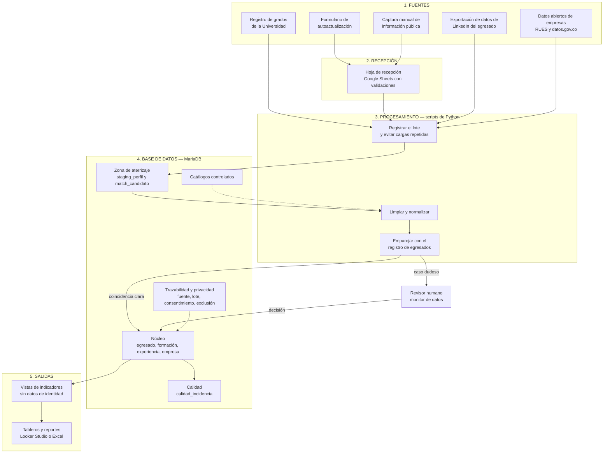
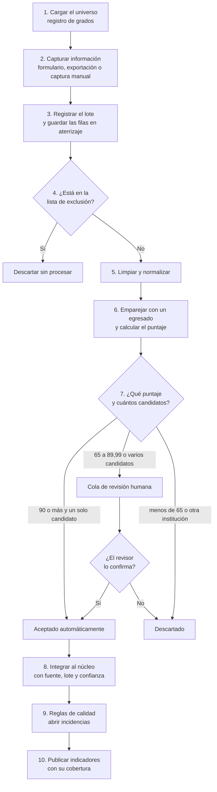

Nombre : Juliana Parra Caro


# 0. Resumen

## 0.1 El problema

La Facultad de Ingeniería quiere saber qué pasa con sus egresados después de graduarse: en qué sectores trabajan, qué cargos ocupan, en qué áreas se desempeñan y dónde viven. Hoy no tiene un proceso ordenado para averiguarlo.

LinkedIn es una fuente útil, pero tiene tres problemas: no todos los egresados tienen perfil, la información de cada perfil es desigual y desactualizada, y sus términos de uso restringen cómo se puede obtener.

## 0.2 La propuesta en pocas palabras

Para el desarrollo de esta prueba técnica, propongo un proceso **ordenado, repetible y barato** que sigue esta lógica:

1. **Partir de lo que la Universidad ya sabe.** El registro oficial de grados es la lista de egresados. No se busca "quién dice haber estudiado aquí" en LinkedIn; se busca a cada persona conocida.
2. **Obtener la información profesional de los propios egresados**, con su autorización, mediante un formulario y la exportación que LinkedIn permite a cada usuario hacer de sus datos. Para quienes no responden, se complementa con captura manual de información pública.
3. **Guardar todo en una base de datos MariaDB** con catálogos estándar, control de calidad, trazabilidad de cada dato y protección de datos personales desde el diseño.
4. **Publicar indicadores agregados, siempre junto a su cobertura**, para que nadie interprete como "todos los egresados" lo que solo es "los egresados de los que se tiene información".

## 0.3 Cuatro decisiones que sostienen la propuesta

| # | Decisión | Por qué |
|---|---|---|
| 1 | **Registro institucional primero, LinkedIn después** | Emparejar un perfil contra una lista conocida reduce los falsos positivos (perfiles de otra persona con el mismo nombre). |
| 2 | **Sin extracción automática de LinkedIn** | Sus Términos de uso prohíben el *scraping* y un proceso construido sobre algo que puede bloquearse mañana no es sostenible. Los datos entran por canales que no dependen de la interfaz de LinkedIn. |
| 3 | **Cada dato lleva su historia** | Todo registro guarda de qué fuente y de qué carga viene, qué tan confiable es y si fue verificado. |
| 4 | **Pocas piezas, todas estándar** | MariaDB, Python, Google Forms/Sheets y Excel. Costo entre 0 y ~10 USD al mes y pocas horas de mantenimiento por semana. |

## 0.4 Cómo leer este documento

La prueba técnica pide siete temas en el documento y seis elementos en la estructura de la base de datos. Este mapa indica dónde está cada uno.

| Lo que pide la prueba | Dónde está |
|---|---|
| Identificación de egresados | Sección 4 |
| Definición de variables | Sección 5 |
| Recolección y consolidación | Secciones 3 (flujo) y 6 |
| Calidad y trazabilidad | Sección 7 |
| Protección de datos | Sección 8 |
| Análisis | Sección 9 |
| Implementación (actividades, recursos, responsables, actualización) | Sección 11 |
| Diccionario de datos | Sección 5 (las 129 variables, tabla por tabla) |
| Estructura de almacenamiento y justificación tecnológica | Secciones 2.3 y 10 |
| Llave única y relaciones | Sección 6.3 |
| Estandarización (programas, sectores, cargos, áreas, ubicaciones) | Sección 6.4 |
| Control de calidad (duplicados, validación, faltantes, fuentes) | Secciones 6.5 y 7 |
| Datos de prueba (5 a 10 registros) | Sección 10.5 - Carpeta `db/`|
| Diagrama de la base de datos | Carpeta `diagramas/` del repositorio |

---

# 1. Alcance y principios

## 1.1 Lo que este trabajo es y lo que no es

- **Es** un documento metodológico y una primera versión de la estructura de la base de datos, con datos de prueba ficticios.
- **No es** una aplicación ni una recolección real de datos. Las herramientas que se nombran (Python, Google Forms, Looker Studio) son la propuesta para cuando la Facultad implemente el proceso.

## 1.2 Principios de diseño

| Principio | Qué significa en la práctica |
|---|---|
| **Repetible** | Cada carga de datos queda registrada y cargar dos veces el mismo archivo no duplica nada. |
| **Explicable** | Cada vez que se empareja un perfil con un egresado se guarda el desglose del puntaje. Siempre se puede responder "¿por qué se aceptó este perfil?". |
| **Una persona decide lo dudoso** | La máquina propone; un humano resuelve los casos poco claros. |
| **Mínimo dato necesario** | Solo se recoge lo que responde a una pregunta de la Facultad. Sin fotos, contactos, publicaciones ni textos libres. |
| **Sostenible** | Pocas herramientas, catálogos que crecen con el uso y tareas de mantenimiento cortas y periódicas. |
| **Honesto con sus límites** | LinkedIn no representa a todos los egresados. Todo indicador se publica junto a su cobertura. |

---

# 2. Arquitectura del sistema

## 2.1 Vista general

El sistema tiene cinco bloques. Los datos entran por la izquierda (fuentes), pasan por recepción y procesamiento, se guardan en la base de datos y salen como indicadores.



**Cómo se lee:** las líneas continuas son el camino de los datos; las punteadas son consultas de apoyo (los catálogos ayudan a normalizar y las tablas de trazabilidad acompañan cada dato que entra al núcleo).

## 2.2 Qué hace cada bloque

| Bloque | Qué hace, en palabras simples | Quién lo usa | Tecnología |
|---|---|---|---|
| **1. Fuentes** | Son los cinco lugares de donde sale la información. Se detallan en la sección 6.1. | Egresados, Oficina de Registro, monitor | Archivos CSV, Google Forms, exportación de LinkedIn, plantilla Excel |
| **2. Recepción** | Un lugar intermedio donde llegan las respuestas del formulario y las capturas manuales. Valida lo básico antes de que el dato toque la base: que la URL tenga forma correcta, que el año sea razonable, que el egresado haya aceptado el tratamiento de datos. | Monitor de datos | Google Sheets y Apps Script (validaciones) |
| **3. Procesamiento** | Un conjunto de scripts cortos que toman los archivos, los registran, limpian el texto, calculan qué tanto se parece cada perfil a un egresado conocido y proponen una decisión. | Soporte de TI (lo mantiene) | Python con `pandas` y `rapidfuzz` |
| **4. Base de datos** | Guarda todo. Tiene **cuatro zonas**: aterrizaje (datos crudos temporales), núcleo (datos ya validados), catálogos (listas estándar) y trazabilidad/privacidad (de dónde viene cada dato y qué permiso hay para usarlo). | Solo los scripts y los roles autorizados | MariaDB |
| **5. Salidas** | Vistas SQL que resumen la información **sin nombres ni documentos** y se conectan a tableros. | Coordinación, Decanatura, jefes de programa | Looker Studio o Excel |
| **Revisor humano** | Mira la cola de casos dudosos y decide si un perfil corresponde o no a un egresado. | Monitor de datos | Consulta a una vista de la cola |

## 2.3 Por qué estas tecnologías

| Tecnología | Rol | Por qué esta y no otra |
|---|---|---|
| **MariaDB** | Almacén único, fuente de verdad | La trayectoria de un egresado es "uno a muchos" (una persona, varias formaciones y varios empleos); un modelo relacional lo representa sin repetir datos. Es gratuita, soporta restricciones de integridad (llaves foráneas, `CHECK`, `UNIQUE`), roles de acceso y **versionado nativo de tablas** para guardar el historial de cambios. Una hoja de cálculo no controla acceso por rol ni garantiza integridad. |
| **Python** | Cargar, limpiar y emparejar | Scripts legibles que cualquier sucesor con conocimientos básicos puede mantener. Existen librerías maduras para comparar textos y leer archivos. |
| **Google Forms, Sheets y Apps Script** | Captura con consentimiento y validación en el origen | La Universidad normalmente ya tiene Workspace, el costo es cero y el egresado no instala nada. |
| **Excel** | Plantilla de captura manual y reportes | Con listas desplegables basadas en los mismos catálogos de la base, quien captura no necesita conocimientos técnicos. |
| **Looker Studio o Excel** | Tableros | Gratuitos y se conectan directamente a las vistas. |
| **Django REST Framework** | *Fase 2, opcional* | Solo si el volumen justifica un portal donde cada egresado actualice su información con un enlace personal. El esquema ya lo permite (`uuid_publico`) pero no se necesita para operar. |
| **Scripts de *scraping*** | **Solo en fuentes que lo permiten** | Para enriquecer **empresas** (no personas) con datos abiertos como RUES o datos.gov.co, y para descargar catálogos oficiales del DANE. **Nunca sobre LinkedIn.** |

## 2.4 Quién accede a qué

| Rol de base de datos (propuesto) | Puede hacer | No puede hacer |
|---|---|---|
| `rol_analista` | Consultar las vistas de indicadores | Ver nombres, documentos o tablas del núcleo |
| `rol_revisor` | Ver y resolver la cola de revisión | Modificar el núcleo directamente |
| `rol_etl` | Escribir cargas y datos del núcleo | Borrar datos del núcleo ni historial |
| Usuario de mantenimiento | Depuración y respaldos | Se usa solo por Soporte de TI |

## 2.5 Costo estimado

| Concepto | Costo |
|---|---|
| MariaDB y Python en un servidor institucional existente | 0 USD |
| Alternativa: servidor virtual pequeño (1–2 GB de RAM) | ~5–10 USD al mes |
| Google Workspace (Forms, Sheets, Drive) | 0 USD si la Universidad ya lo tiene |
| Looker Studio | 0 USD |
| Copias de seguridad semanales | 0 USD (almacenamiento institucional o Drive) |
| Personal | 1 monitor de datos (~10 h/semana), 2 h/semana del coordinador de egresados y soporte de TI ocasional |

> *Son estimaciones de orden de magnitud; deben confirmarse con los precios y la infraestructura reales de la Universidad.*

---

# 3. Flujo de trabajo paso a paso

Esta es la sección operativa: **qué se hace, en qué orden y quién lo hace**. El flujo completo se repite cada vez que llega un nuevo lote de información (mensualmente, según la sección 11.3).

## 3.1 El flujo en una imagen



## 3.2 Los diez pasos

| Paso | Qué ocurre | Quién | Herramienta | Qué queda registrado |
|---|---|---|---|---|
| **1. Cargar el universo** | La Oficina de Registro entrega la lista de graduados (nombre, programa, año, documento). Se cargan como egresados y como su formación en la Facultad. El documento se transforma en un código irreversible (HMAC-SHA256) y nunca se guarda en claro. | Oficina de Registro + TI | CSV → Python | Fuente 1, lote, nivel de confianza 90 |
| **2. Capturar información profesional** | Se obtienen datos laborales por tres canales: (a) el egresado llena el formulario; (b) el egresado entrega la exportación de sus datos de LinkedIn; (c) el monitor consulta a mano información pública de quienes no respondieron. | Egresado o monitor | Google Forms, archivo de LinkedIn, plantilla Excel | Canal de origen y consentimiento |
| **3. Registrar el lote** | Cada archivo recibido se identifica con su huella digital (SHA-256). Si ya fue cargado, el proceso se detiene. Si es nuevo, sus filas se guardan en la zona de aterrizaje con una **fecha límite de conservación de 90 días**. | Script de Python | Python → MariaDB | Lote: archivo, cantidad de filas, estado |
| **4. Revisar la lista de exclusión** | Antes de procesar, se verifica que la persona no haya pedido ser eliminada o no ser contactada. Si está, la fila se descarta. | Script | MariaDB (`lista_exclusion`) | Conteo de filas rechazadas |
| **5. Limpiar y normalizar** | Se estandariza el texto: minúsculas, sin tildes ni signos, abreviaturas expandidas (`Ing.` → `ingeniería`), sufijos de empresa retirados (S.A.S., Ltda.), fechas a formato `AAAA-MM-01`. | Script | Python | El texto original se conserva tal cual junto al estandarizado |
| **6. Emparejar** | Se compara cada perfil con los egresados conocidos y se calcula un puntaje de 0 a 100 (ver sección 4.3). | Script | Python (`rapidfuzz`) | Desglose del puntaje por componente |
| **7. Decidir** | Con base en el puntaje se acepta, se envía a revisión o se descarta. Los casos dudosos van a la cola. | Script y revisor | Vista de la cola de revisión | Decisión y quién la tomó |
| **8. Integrar al núcleo** | Los datos aceptados se estandarizan con los catálogos y se guardan sin duplicar (si ya existen se actualizan). Cada fila lleva su fuente, su lote, su nivel de confianza y su estado de verificación. | Script | Python → MariaDB | Trazabilidad completa del dato |
| **9. Aplicar reglas de calidad** | Se ejecutan consultas que detectan lo incompleto, desactualizado, ambiguo o duplicado y abren incidencias. | Script programado | SQL | Incidencias con severidad y estado |
| **10. Publicar indicadores** | Se refrescan las vistas y los tableros. Cada indicador se muestra junto a su cobertura. | Monitor y Coordinación | Looker Studio o Excel | — |

**Cierre del ciclo.** Al terminar un lote se guardan sus contadores (leídos, insertados, actualizados, en revisión, rechazados) y se purga la zona de aterrizaje vencida.

## 3.3 Ejemplo recorrido de principio a fin

> *Caso ficticio para ilustrar el flujo.*

1. **Paso 1.** El registro de grados incluye a **Camila Rojas Pardo**, Ingeniería de Sistemas y Computación, grado en 2018. Queda en la base como egresada, con su documento convertido en código.
2. **Paso 2.** Camila recibe el correo de grados con el enlace al formulario, lo llena, acepta el tratamiento de datos y pega su perfil de LinkedIn.
3. **Pasos 3 y 4.** La respuesta llega a la hoja de recepción; el script la registra en un lote y comprueba que Camila no está en la lista de exclusión.
4. **Paso 5.** El programa escrito por ella como "Ing. Sistemas" se convierte, por el catálogo de alias, en *Ingeniería de Sistemas y Computación*. El cargo "Software Developer Sr." se guarda tal cual y se asigna al cargo estándar "Desarrollador de software".
5. **Pasos 6 y 7.** Como ella misma entregó su URL con autorización, el puntaje de coincidencia es como mínimo 95 y hay un solo candidato: **se acepta automáticamente**.
6. **Paso 8.** Se crea su experiencia laboral actual (`es_actual = 1`) con la empresa, la ciudad donde trabaja, la fuente "formulario" y confianza 95. La empresa ya tenía sector económico asignado.
7. **Paso 9.** Las reglas de calidad no encuentran problemas.
8. **Paso 10.** Camila cuenta en el indicador de vinculación de su programa, en el sector de su empresa y en la ciudad donde trabaja, **sin que ninguna vista muestre su nombre**.

Si en cambio el perfil hubiera sido capturado a mano y existieran dos egresados compatibles con el mismo nombre, ninguno se habría aceptado automáticamente: el caso habría ido a la cola para que el monitor decida.

---

# 4. Identificación de egresados

## 4.1 Estrategia: de lo conocido a lo desconocido

**Ruta A (preferida): partir del registro institucional.** Se carga la lista oficial de graduados. Para cada persona se busca *su* perfil, no se recorre LinkedIn a ciegas. Esto evita buscar "Universidad X" y quedarse con lo que aparezca.

**Ruta B (complementaria): descubrimiento.** Para egresados que no están en el registro (años antiguos, programas cerrados) se usa lo que el propio egresado entrega o lo que aparece en la página institucional de la Universidad en LinkedIn. Estos registros nacen con confianza menor y **siempre pasan por revisión humana**.

**Ruta C: agregados de LinkedIn como contraste.** La página universitaria de LinkedIn ofrece estadísticas *agregadas* (dónde trabajan, qué hacen). No identifican personas, pero sirven para comparar: ¿la distribución de mi base se parece a la de la población?

## 4.2 Cómo se identifica a un egresado de la Facultad

Una persona pertenece al universo de la Facultad si tiene **al menos una formación con un programa de la Facultad** (`cat_programa.es_facultad = 1`). El programa se identifica por su código SNIES, y las variantes de escritura ("Ing. Sistemas", "Ingeniería de Sistemas") se reconocen mediante la tabla de alias.

## 4.3 Cómo se verifica que un perfil corresponde a un egresado

Se calcula un **puntaje de 0 a 100** sumando cinco componentes:

| Componente | Peso | Cómo se mide |
|---|---|---|
| Nombre | 40 | Similitud entre nombres ya normalizados (sin tildes, palabras en cualquier orden). Tolera que falte el segundo nombre. |
| Programa | 25 | Coincidencia con el nombre oficial o con un alias; o similitud alta. |
| Año de grado | 15 | Mismo año: 15 · diferencia de 1 año: 10 · de 2 años: 5 · otro: 0. |
| Institución | 15 | **Compuerta**: si el perfil dice que estudió en otra universidad, el puntaje es 0 y se descarta. |
| Corroboración | 5 | La ciudad coincide. |
| *Excepción* | — | Si el egresado entregó su propia URL con autorización, el puntaje mínimo es 95 (verificación directa). |

**Decisión según el puntaje:**

| Resultado | Qué pasa |
|---|---|
| **90 o más y un solo candidato** | Se acepta automáticamente (`verificado_automatico`). |
| **65 a 89,99, o más de un candidato compatible** | Va a la cola de revisión humana. |
| **Menos de 65, o falla la compuerta de institución** | Se descarta. |

**Homónimos.** Si dos egresados del registro son compatibles con el mismo perfil (o al revés), **ninguno se acepta automáticamente**; siempre decide una persona.

**Calibración.** Los umbrales (90 y 65) son un punto de partida. Antes de operar se etiquetan a mano **100 pares** (unos 50 correctos y 50 incorrectos), se mide la precisión y se ajusta. Meta: **precisión de 95 % o más en lo aceptado automáticamente**. Cada año se repite con una muestra de 50.

---

# 5. Definición de variables

Esta sección recoge **todas las variables de la base de datos**: 129 columnas en 21 tablas. Primero se explica qué información de negocio se recoge y por qué; después se listan, tabla por tabla, todas las columnas con su tipo, obligatoriedad y reglas de validación. El diagrama entidad–relación está en la carpeta `diagramas/` y el script de creación en `database/`.

## 5.1 Qué se recoge y por qué

Se recoge solo lo que responde a una pregunta de la Facultad.

| Información | Dónde se guarda | Pregunta que responde |
|---|---|---|
| Programa y año de grado | `formacion_academica` | ¿A qué cohorte y programa pertenece? |
| Otras formaciones (posgrado) | `formacion_academica` | ¿Cuántos siguen estudiando y dónde? |
| Empresa y sector económico | `empresa` → `cat_sector_ciiu` | ¿Quiénes son los empleadores y en qué sectores trabajan? |
| Cargo, área y nivel jerárquico | `experiencia_laboral` | ¿Qué hacen realmente y cómo progresan? |
| Tipo de vinculación | `experiencia_laboral` | ¿Empleados, independientes, emprendedores, practicantes? |
| Fechas y empleo actual | `experiencia_laboral` | ¿Cuánto tarda el primer empleo? ¿Quiénes tienen hoy empleo vigente? |
| Ubicación del cargo | `experiencia_laboral` → `cat_ubicacion` | ¿Dónde trabajan? ¿Cuántos salen del país? |
| Perfil público y documento (como código) | `egresado` | ¿Cómo se vincula el registro con su fuente sin exponer datos sensibles? |
| Fuente, lote, confianza y verificación | Núcleo, `cat_fuente`, `lote_carga` | ¿De dónde viene el dato y qué tan confiable es? |
| Consentimiento y exclusión | `consentimiento`, `lista_exclusion` | ¿Con qué permiso se usa el dato? ¿Quién pidió no ser tratado? |

**Lo que deliberadamente NO se recoge:** fotografía, correo, teléfono, descripción libre del cargo, habilidades, recomendaciones, publicaciones, contactos, fecha de nacimiento, género ni ningún dato sensible (Ley 1581 de 2012, art. 5). Si la Facultad necesita contactar al egresado, usa los canales institucionales que ya tiene autorizados.

## 5.2 Cómo leer las tablas del diccionario

- **Oblig.:** "Sí" significa que el campo no puede quedar vacío (`NOT NULL`). "No" significa que puede estar vacío.
- **PK** es la llave primaria (número entero que se asigna solo y nunca se reutiliza). **FK** es una llave foránea: apunta a un registro de otra tabla y la base impide que apunte a uno que no existe.
- **Único** significa que el valor no puede repetirse en la tabla.
- **Valores permitidos:** donde el esquema usa un texto (`VARCHAR`) con una lista de valores, la lista es una **convención que valida la carga y las reglas de calidad**; el esquema solo fuerza con `CHECK` los rangos numéricos que se indican.
- Las tablas `formacion_academica` y `experiencia_laboral` tienen además dos columnas internas de **versionado** que MariaDB agrega y mantiene sola (inicio y fin de vigencia de cada versión de la fila). No se llenan a mano.

## 5.3 Núcleo

### `egresado`: la persona

| Variable | Tipo | Oblig. | Descripción y reglas |
|---|---|---|---|
| `egresado_id` | INT | Sí | PK. Identificador interno, automático y nunca reutilizado. |
| `uuid_publico` | CHAR(36) | Sí | Único. Identificador opaco (UUID) para intercambios externos sin revelar la secuencia interna. |
| `documento_hash` | VARCHAR(64) | No | Único. Código HMAC-SHA256 del documento de identidad; el documento nunca se guarda en claro. |
| `linkedin_slug` | VARCHAR(100) | No | Único. Solo la parte del perfil después de `/in/`, en minúsculas. |
| `estado_registro` | VARCHAR(30) | No | Por defecto `activo`. Valores: `activo`, `fusionado`. |
| `fusionado_en_id` | INT | No | FK → `egresado`. Si el registro es un duplicado confirmado, apunta al que sobrevive. Si ese se elimina, pasa a vacío (`ON DELETE SET NULL`). |
| `creado_en` | DATETIME | No | Fecha de creación, automática. |
| `actualizado_en` | DATETIME | No | Fecha de la última modificación, automática. |

### `formacion_academica`: estudios (versionada)

| Variable | Tipo | Oblig. | Descripción y reglas |
|---|---|---|---|
| `formacion_id` | INT | Sí | PK, automático. |
| `egresado_id` | INT | Sí | FK → `egresado`. Si se borra la persona, se borran sus formaciones. |
| `programa_id` | INT | No | FK → `cat_programa`. Programa estandarizado. Obligatorio por regla de carga cuando la formación es de la Facultad. |
| `institucion_id` | INT | No | FK → `cat_institucion`. Institución donde estudió. |
| `texto_original_programa` | VARCHAR(200) | No | Programa tal como vino de la fuente, sin corregir (auditoría de la estandarización). |
| `anio_grado` | INT | No | Año de grado. `CHECK` entre 1950 y 2100. |
| `nivel_formacion` | VARCHAR(50) | Sí | Valores: pregrado, especialización, maestría, doctorado, técnico o tecnólogo, otro. |
| `fuente_id` | INT | Sí | FK → `cat_fuente`. De dónde salió el dato. |
| `lote_id` | INT | Sí | FK → `lote_carga`. En qué carga entró. |
| `nivel_confianza` | INT | No | `CHECK` entre 0 y 100. Hereda la confianza de la fuente. |
| `estado_verificacion` | VARCHAR(30) | No | Por defecto `sin_verificar`. Valores: `sin_verificar`, `verificado_automatico`, `verificado_manual`, `verificado_egresado`, `verificado_institucional`, `rechazado`. |
| `creado_en` | DATETIME | No | Automático. |
| `actualizado_en` | DATETIME | No | Automático. |

### `empresa`: empleadores

| Variable | Tipo | Oblig. | Descripción y reglas |
|---|---|---|---|
| `empresa_id` | INT | Sí | PK, automático. |
| `nombre_oficial` | VARCHAR(150) | Sí | Nombre como se conoce oficialmente. |
| `nombre_normalizado` | VARCHAR(150) | Sí | Único. Sin tildes, signos ni sufijos (S.A.S., Ltda.). Evita la misma empresa escrita de formas distintas. |
| `nit` | VARCHAR(20) | No | Único. Solo dígitos, si existe. |
| `sector_ciiu_id` | INT | No | FK → `cat_sector_ciiu`. El sector se asigna a la empresa, no a cada experiencia, para que no se contradiga. |

### `experiencia_laboral`: empleos (versionada)

| Variable | Tipo | Oblig. | Descripción y reglas |
|---|---|---|---|
| `experiencia_id` | INT | Sí | PK, automático. |
| `egresado_id` | INT | Sí | FK → `egresado`. Si se borra la persona, se borran sus experiencias. |
| `empresa_id` | INT | Sí | FK → `empresa`. |
| `cargo_original` | VARCHAR(150) | Sí | Cargo tal cual vino de la fuente. |
| `cargo_estandar_id` | INT | No | FK → `cat_cargo_normalizado`. Vacío si no se pudo clasificar (genera la incidencia R04). |
| `area_desempeno_id` | INT | No | FK → `cat_area_desempeno`. |
| `nivel_jerarquico_id` | INT | No | FK → `cat_nivel_jerarquico`. |
| `tipo_vinculacion` | VARCHAR(50) | No | Valores: contrato laboral, prestación de servicios o independiente, fundador o emprendedor, práctica o pasantía, otro. Separa las prácticas del empleo profesional. |
| `fecha_inicio` | DATE | Sí | Formato `AAAA-MM-01` cuando solo se conoce el mes. |
| `fecha_fin` | DATE | No | Vacía si el empleo continúa o se desconoce el cierre. No puede ser anterior a `fecha_inicio` (se valida en la carga). |
| `precision_inicio` | VARCHAR(10) | No | Qué tan exacta es la fecha de inicio. Por defecto `Y-m`. Valores: `Y` (solo año), `Y-m` (año y mes), `Y-m-d` (fecha completa). |
| `es_actual` | BOOLEAN | Sí | Por defecto 0. `1` identifica el empleo vigente y debe ir con `fecha_fin` vacía. Se permiten varios en cargos paralelos. Ver 10.3-B. |
| `ubicacion_id` | INT | No | FK → `cat_ubicacion`. Dónde se ejerce el cargo; vacío significa "desconocida", no "igual a la empresa". Ver 10.3-A. |
| `fuente_id` | INT | Sí | FK → `cat_fuente`. |
| `lote_id` | INT | Sí | FK → `lote_carga`. |
| `nivel_confianza` | INT | No | `CHECK` entre 0 y 100. |
| `estado_verificacion` | VARCHAR(30) | No | Por defecto `sin_verificar`. Mismos valores que en `formacion_academica`. |
| `creado_en` | DATETIME | No | Automático. |
| `actualizado_en` | DATETIME | No | Automático. |

**Restricción única `uq_experiencia`:** no puede haber dos experiencias con el mismo egresado, empresa, cargo original y fecha de inicio. Así, cargar dos veces el mismo dato actualiza en lugar de duplicar.

## 5.4 Catálogos controlados

Las listas estándar. Los valores concretos propuestos están en la sección 6.4.

### `cat_programa` y `cat_programa_alias`

| Variable | Tipo | Oblig. | Descripción y reglas |
|---|---|---|---|
| `cat_programa.programa_id` | INT | Sí | PK, automático. |
| `cat_programa.codigo_snies` | VARCHAR(20) | Sí | Único. Código oficial del programa en el SNIES. |
| `cat_programa.nombre_programa` | VARCHAR(150) | Sí | Nombre oficial del programa. |
| `cat_programa.es_facultad` | BOOLEAN | No | Por defecto 1. Indica si el programa es de la Facultad; define quién pertenece al universo. |
| `cat_programa_alias.alias_id` | INT | Sí | PK, automático. |
| `cat_programa_alias.programa_id` | INT | Sí | FK → `cat_programa`. Si se borra el programa, se borran sus alias. |
| `cat_programa_alias.alias_texto` | VARCHAR(150) | Sí | Único. Otra forma de escribir el programa (p. ej. "Ing. Sistemas"). |

### `cat_institucion` y `cat_institucion_alias`

| Variable | Tipo | Oblig. | Descripción y reglas |
|---|---|---|---|
| `cat_institucion.institucion_id` | INT | Sí | PK, automático. |
| `cat_institucion.nombre_institucion` | VARCHAR(150) | Sí | Único. Nombre oficial. |
| `cat_institucion.es_propia` | BOOLEAN | No | Por defecto 0. `1` marca a la Universidad propia; es la base de la compuerta de institución en el emparejamiento. |
| `cat_institucion_alias.alias_id` | INT | Sí | PK, automático. |
| `cat_institucion_alias.institucion_id` | INT | Sí | FK → `cat_institucion`. Si se borra la institución, se borran sus alias. |
| `cat_institucion_alias.alias_texto` | VARCHAR(150) | Sí | Único. Otra forma de escribir la institución. |

### `cat_sector_ciiu`

| Variable | Tipo | Oblig. | Descripción y reglas |
|---|---|---|---|
| `sector_ciiu_id` | INT | Sí | PK, automático. |
| `codigo_ciiu` | VARCHAR(10) | Sí | Único. Código CIIU Rev. 4 A.C. (DANE). |
| `seccion` | VARCHAR(5) | Sí | Letra de la sección CIIU. |
| `descripcion_seccion` | VARCHAR(255) | Sí | Nombre de la sección. |
| `division` | VARCHAR(5) | Sí | Código de la división CIIU. |
| `descripcion_division` | VARCHAR(255) | Sí | Nombre de la división. |

### `cat_cargo_normalizado` y `cat_cargo_alias`

| Variable | Tipo | Oblig. | Descripción y reglas |
|---|---|---|---|
| `cat_cargo_normalizado.cargo_normalizado_id` | INT | Sí | PK, automático. |
| `cat_cargo_normalizado.nombre_cargo_base` | VARCHAR(100) | Sí | Único. Familia de cargo estándar (p. ej. "Desarrollador de software"). |
| `cat_cargo_alias.alias_id` | INT | Sí | PK, automático. |
| `cat_cargo_alias.cargo_normalizado_id` | INT | Sí | FK → `cat_cargo_normalizado`. Si se borra la familia, se borran sus alias. |
| `cat_cargo_alias.alias_texto` | VARCHAR(100) | Sí | Único. Título libre que se traduce a la familia (p. ej. "Software Developer Sr."). |

### `cat_area_desempeno`

| Variable | Tipo | Oblig. | Descripción y reglas |
|---|---|---|---|
| `area_desempeno_id` | INT | Sí | PK, automático. |
| `nombre_area` | VARCHAR(100) | Sí | Único. Una de las 12 áreas funcionales. |
| `descripcion` | TEXT | No | Qué incluye el área. |

### `cat_nivel_jerarquico`

| Variable | Tipo | Oblig. | Descripción y reglas |
|---|---|---|---|
| `nivel_jerarquico_id` | INT | Sí | PK, automático. |
| `nivel` | INT | Sí | Único. Posición en la escala (1 a 6); permite ordenar y medir progresión. |
| `nombre_nivel` | VARCHAR(50) | Sí | Nombre del nivel (p. ej. "Profesional o analista"). |

### `cat_ubicacion`

| Variable | Tipo | Oblig. | Descripción y reglas |
|---|---|---|---|
| `ubicacion_id` | INT | Sí | PK, automático. |
| `pais` | VARCHAR(100) | Sí | Nombre del país. |
| `codigo_iso_pais` | CHAR(2) | Sí | Código ISO 3166-1 de dos letras (p. ej. `CO`, `ES`, `MX`). |
| `departamento_o_estado` | VARCHAR(100) | No | Departamento (Colombia) o estado/provincia (exterior). |
| `municipio_o_ciudad` | VARCHAR(100) | No | Municipio o ciudad. Es el nivel máximo de detalle que se guarda. |
| `codigo_divipola` | VARCHAR(10) | No | Código DIVIPOLA (DANE); solo para ubicaciones en Colombia. |

## 5.5 Trazabilidad y lotes de carga

### `cat_fuente`

| Variable | Tipo | Oblig. | Descripción y reglas |
|---|---|---|---|
| `fuente_id` | INT | Sí | PK, automático. |
| `nombre_fuente` | VARCHAR(100) | Sí | Único. Una de las cinco fuentes de la sección 6.1. |
| `confianza_base` | INT | No | `CHECK` entre 0 y 100. Confianza inicial que heredan los datos de esta fuente. |
| `descripcion` | TEXT | No | Qué aporta la fuente y su base legal. |

### `lote_carga`

| Variable | Tipo | Oblig. | Descripción y reglas |
|---|---|---|---|
| `lote_id` | INT | Sí | PK, automático. |
| `fuente_id` | INT | Sí | FK → `cat_fuente`. |
| `archivo_hash` | CHAR(64) | Sí | Único. Huella SHA-256 del archivo; impide cargarlo dos veces. |
| `nombre_archivo` | VARCHAR(255) | Sí | Nombre del archivo recibido. |
| `registros_leidos` | INT | No | Por defecto 0. Filas leídas del archivo. |
| `registros_insertados` | INT | No | Por defecto 0. Filas nuevas creadas. |
| `registros_actualizados` | INT | No | Por defecto 0. Filas existentes actualizadas. |
| `estado` | VARCHAR(30) | No | Por defecto `procesando`. Al cerrar el lote pasa a un estado final (p. ej. `completado` o `con_errores`). |
| `creado_en` | DATETIME | No | Fecha de la carga. Sirve como fecha de observación de los datos del lote. |

## 5.6 Protección de datos y privacidad

### `consentimiento`

| Variable | Tipo | Oblig. | Descripción y reglas |
|---|---|---|---|
| `consentimiento_id` | INT | Sí | PK, automático. |
| `egresado_id` | INT | Sí | FK → `egresado`. Si se borra la persona, se borran sus consentimientos. |
| `otorgado` | BOOLEAN | Sí | 1 si la persona autorizó el tratamiento; 0 si no (p. ej. captura de datos públicos con aviso al titular). |
| `fecha_otorgamiento` | DATETIME | No | Fecha del registro del consentimiento, automática. |
| `canal_recoleccion` | VARCHAR(50) | Sí | Por dónde se obtuvo: `formulario`, `exportacion_linkedin`, `captura_manual`, `registro_institucional`. |
| `version_politica` | VARCHAR(20) | Sí | Versión de la política de tratamiento aceptada (p. ej. `v1.0`). |
| `finalidad` | TEXT | Sí | Para qué se tratan los datos (seguimiento de egresados y estadísticas de la Facultad). |

### `lista_exclusion`

| Variable | Tipo | Oblig. | Descripción y reglas |
|---|---|---|---|
| `exclusion_id` | INT | Sí | PK, automático. |
| `documento_hash` | VARCHAR(64) | No | Único. Código del documento de quien pidió ser excluido. |
| `linkedin_slug` | VARCHAR(100) | No | Único. Perfil de quien pidió ser excluido. |
| `motivo` | VARCHAR(255) | Sí | Por qué se excluyó (revocación, reclamo, supresión). |
| `registrado_en` | DATETIME | No | Fecha del registro, automática. |

Al menos uno de los dos identificadores (`documento_hash` o `linkedin_slug`) debe estar lleno; se valida en la carga.

## 5.7 Procesamiento y calidad

### `staging_perfil`: zona de aterrizaje (temporal)

| Variable | Tipo | Oblig. | Descripción y reglas |
|---|---|---|---|
| `staging_id` | INT | Sí | PK, automático. |
| `lote_id` | INT | Sí | FK → `lote_carga`. |
| `fila_numero` | INT | Sí | Número de la fila dentro del archivo original. |
| `payload_json` | JSON | Sí | La fila cruda completa, tal como llegó. |
| `hash_fila` | CHAR(64) | Sí | Huella SHA-256 de la fila; detecta filas repetidas. |
| `purgar_despues` | DATETIME | Sí | Fecha límite de conservación (máximo 90 días). |
| `procesado` | BOOLEAN | No | Por defecto 0. Pasa a 1 cuando la fila ya fue emparejada. |

### `match_candidato`: decisiones de emparejamiento

| Variable | Tipo | Oblig. | Descripción y reglas |
|---|---|---|---|
| `match_id` | INT | Sí | PK, automático. |
| `staging_id` | INT | Sí | FK → `staging_perfil`. Si se purga la fila cruda, se borran sus candidatos. |
| `egresado_id` | INT | Sí | FK → `egresado`. Egresado candidato. |
| `puntaje_total` | DECIMAL(5,2) | Sí | Puntaje final de 0 a 100. |
| `puntaje_nombre` | DECIMAL(5,2) | No | Parte del puntaje por nombre (máximo 40). |
| `puntaje_programa` | DECIMAL(5,2) | No | Parte del puntaje por programa (máximo 25). |
| `puntaje_anio` | DECIMAL(5,2) | No | Parte del puntaje por año de grado (máximo 15). |
| `puntaje_institucion` | DECIMAL(5,2) | No | Parte del puntaje por institución (máximo 15). |
| `estado_decision` | VARCHAR(30) | No | Por defecto `pendiente_revision`. Valores: `pendiente_revision`, `auto_aceptado`, `aceptado_manual`, `descartado_auto`, `descartado_manual`. |

### `calidad_incidencia`

| Variable | Tipo | Oblig. | Descripción y reglas |
|---|---|---|---|
| `incidencia_id` | INT | Sí | PK, automático. |
| `codigo_regla` | VARCHAR(10) | Sí | Regla que la detectó: `R01` a `R08` (sección 7.2). |
| `egresado_id` | INT | No | FK → `egresado`. Persona afectada; puede estar vacío si la incidencia no es de una persona. |
| `descripcion` | TEXT | Sí | Qué se encontró, en lenguaje legible. |
| `severidad` | VARCHAR(20) | Sí | Valores: `alta`, `media`, `baja`. |
| `estado` | VARCHAR(20) | No | Por defecto `abierta`. Valores: `abierta`, `resuelta`, `ignorada`. |
| `detectado_en` | DATETIME | No | Fecha de detección, automática. |

---

# 6. Recolección y consolidación

## 6.1 Fuentes (todas registradas en `cat_fuente`)

| # | Fuente | Qué aporta | Confianza base (0–100) |
|---|---|---|---|
| 1 | Registro institucional de grados | Universo, programa, año | 90 |
| 2 | Formulario de autoactualización | Trayectoria actual, validada en origen y con consentimiento | 95 |
| 3 | **Exportación de datos de LinkedIn entregada por el egresado** | Historial completo y estructurado, sin necesidad de extraer nada | 90 |
| 4 | Captura manual de información pública | Cobertura de quienes no responden | 60 |
| 5 | Datos abiertos de empresas (RUES, datos.gov.co) | Sector económico de la **empresa** | 70 |

**La fuente 3 es la de mayor valor.** LinkedIn permite a cada usuario solicitar una copia de sus propios datos; ese archivo ya trae cargos, empresas, fechas y formación en columnas. Es legítima (la entrega el titular), estructurada y no depende de cómo se vea la página de LinkedIn.

## 6.2 Reglas para integrar los registros

1. **Un archivo nunca se carga dos veces.** Su huella SHA-256 está registrada en `lote_carga` y debe ser única.
2. **Lo crudo no vive para siempre.** Las filas de aterrizaje tienen fecha de purga (máximo 90 días).
3. **Solo entra al núcleo lo aceptado**, sea automáticamente o por un revisor.
4. **Se actualiza, no se duplica.** Las llaves naturales evitan repeticiones (ver 6.3 y 6.5).
5. **Nunca se borra el texto original.** Se guarda junto al valor estandarizado.
6. **Todo dato nuevo hereda la confianza de su fuente.** Si una fuente de mayor confianza lo confirma, se sube; si dos fuentes se contradicen, se abre una incidencia.

## 6.3 Llave única y relaciones

- **Llave primaria de `egresado`: `egresado_id`**, un número entero interno que nunca se reutiliza. No se usa el nombre ni el documento como identificador porque pueden cambiar o ser sensibles.
- **Identificador externo: `uuid_publico`**, un código opaco para APIs o intercambios que no deben revelar la secuencia interna.
- **Llaves naturales de emparejamiento** (únicas, pueden estar vacías): `documento_hash` y `linkedin_slug`.
- **Relaciones:**

| Relación | Significado |
|---|---|
| `egresado` 1—N `formacion_academica` | Una persona puede tener varias formaciones (pregrado, posgrado, un segundo programa de la Facultad). |
| `egresado` 1—N `experiencia_laboral` | Una persona puede tener varios empleos a lo largo del tiempo. |
| `experiencia_laboral` N—1 `empresa` | Muchas experiencias pueden ser en la misma empresa. |
| `experiencia_laboral` N—1 `cat_ubicacion` (opcional) | Dónde se ejerce el cargo. |
| `empresa` N—1 `cat_sector_ciiu` | Cada empresa tiene un sector económico. |
| `egresado` 1—N `consentimiento` | Los permisos de la persona, con su historia. |
| `egresado` N—1 `egresado` (`fusionado_en_id`) | Cuando dos registros resultan ser la misma persona, uno apunta al que sobrevive. |

- **Una experiencia por fila.** Nunca se usan columnas repetidas como `empresa_1`, `empresa_2`: cada experiencia es un registro nuevo.

## 6.4 Estandarización: categorías comunes

Los valores libres que escribe la gente (o que trae LinkedIn) se traducen a listas cerradas. El texto original siempre se conserva.

| Dimensión | Estándar propuesto | Cómo se mantiene |
|---|---|---|
| **Programas** | Lista oficial de la Facultad con código SNIES + tabla de alias (`cat_programa`, `cat_programa_alias`) | Cada variante nueva que aparece se agrega como alias. |
| **Instituciones** | `cat_institucion` + alias; marca cuál es la propia | Igual que programas. |
| **Sectores económicos** | **CIIU Rev. 4 A.C.** (DANE), con sección y división | Catálogo oficial; se asigna a la empresa, idealmente por NIT/RUES. |
| **Cargos** | Familias de cargos (`cat_cargo_normalizado`, unas 13 al inicio: desarrollador de software, analista de datos, ingeniero de proyectos, consultor, docente, etc.) + títulos libres como alias | Cada trimestre se revisan los cargos sin clasificar más frecuentes y se agregan alias. No se busca clasificar el 100 % desde el primer día. |
| **Áreas de desempeño** | 12 áreas propuestas (ver abajo) | Lista cerrada, revisada cada año con los jefes de programa. |
| **Nivel jerárquico** | 6 niveles ordenados (ver abajo) | Permite medir progresión. |
| **Ubicaciones** | **DIVIPOLA** (DANE) en Colombia; **ISO 3166-1** para el exterior | Catálogo oficial. |
| **Tipo de vinculación** | Contrato laboral · Prestación de servicios o independiente · Fundador o emprendedor · Práctica o pasantía · Otro | Lista cerrada. |
| **Nivel de formación** | Pregrado · Especialización · Maestría · Doctorado · Técnico o tecnólogo · Otro | Lista cerrada. |

**Áreas de desempeño (propuesta inicial, a validar con jefes de programa):**
1. Desarrollo de software y TI · 2. Datos, analítica e inteligencia artificial · 3. Infraestructura, redes y ciberseguridad · 4. Gestión de proyectos · 5. Operaciones, producción y manufactura · 6. Calidad y mejora de procesos · 7. Logística y cadena de suministro · 8. Diseño y construcción de infraestructura · 9. Energía, electricidad y electrónica · 10. Consultoría y servicios profesionales · 11. Docencia e investigación · 12. Gerencia, emprendimiento y comercial.

**Niveles jerárquicos (propuesta inicial):**
1. Practicante o aprendiz · 2. Auxiliar o junior · 3. Profesional o analista · 4. Senior o especialista · 5. Coordinación o jefatura · 6. Dirección, alta gerencia o fundador.

## 6.5 Cómo se detectan y resuelven los duplicados

| Tipo de duplicado | Cómo se detecta | Cómo se resuelve |
|---|---|---|
| Misma persona cargada dos veces | Las llaves únicas (`documento_hash`, `linkedin_slug`) impiden la inserción. | Se actualiza el registro existente. |
| Misma persona con datos distintos (p. ej. con y sin segundo nombre) | Similitud difusa en el emparejamiento y regla de calidad R08. | Revisión humana; si se confirma, el registro duplicado pasa a `estado_registro = 'fusionado'` y `fusionado_en_id` apunta al que sobrevive. |
| Misma experiencia repetida | Restricción única `uq_experiencia` (egresado + empresa + cargo + fecha de inicio). | Se actualiza, no se duplica. |
| Misma empresa escrita de formas distintas | `nombre_normalizado` único (sin sufijos, tildes ni signos) y NIT. | Se une al registro existente; las variantes nuevas van a revisión. |

---

# 7. Calidad y trazabilidad

## 7.1 Metadatos que lleva cada registro del núcleo

| Campo | Para qué sirve |
|---|---|
| `fuente_id` | De qué fuente salió (cadena de origen del dato). |
| `lote_id` | En qué carga entró; permite revertir un lote defectuoso y saber cuándo se observó el dato (por la fecha del lote). |
| `nivel_confianza` (0–100) | Cuánto confiar en el dato. Los indicadores usan solo datos con confianza de 60 o más. |
| `estado_verificacion` | `sin_verificar` · `verificado_automatico` · `verificado_manual` · `verificado_egresado` · `verificado_institucional` · `rechazado`. |
| `creado_en` y `actualizado_en` | Auditoría técnica. |
| Historial de cambios | Versionado nativo de MariaDB en `formacion_academica` y `experiencia_laboral`: permite consultar qué valor tenía un dato en cualquier fecha pasada. |

## 7.2 Reglas de calidad

Se ejecutan a diario como consultas SQL y abren una **incidencia** (`calidad_incidencia`) con su severidad. Una incidencia puede marcarse como `ignorada` si es un falso positivo confirmado y no se vuelve a abrir.

| Código | Qué detecta | Tipo de problema | Severidad |
|---|---|---|---|
| R01 | Egresado activo sin formación de la Facultad | Fuera del universo | Alta |
| R02 | Egresado sin ninguna experiencia | **Incompleto** | Media |
| R03 | Empleo actual (`es_actual = 1`) cuyo lote tiene más de 24 meses | **Desactualizado** | Media |
| R04 | Cargo sin estandarizar | Incompleto | Baja |
| R05 | Empresa sin sector CIIU | Incompleto | Baja |
| R06 | Dos empleos de tiempo completo solapados más de 3 meses | **Ambiguo** | Media |
| R07 | Dato con confianza menor a 60 sin verificar | **No verificable** | Alta |
| R08 | Posibles duplicados | Duplicado | Alta |

Además, la propia base impide ciertos errores estructurales: duplicados exactos (`UNIQUE`), relaciones rotas (llaves foráneas) y valores fuera de rango (`CHECK` en año de grado y nivel de confianza). Otras validaciones, como que la fecha de fin no sea anterior a la de inicio o que un empleo con `es_actual = 1` no tenga fecha de fin, se aplican en la carga y en las reglas de calidad.

## 7.3 Indicadores de salud del dato (se publican siempre)

| Indicador | Definición | Meta inicial |
|---|---|---|
| **Cobertura** | % del universo con empleo actual verificado | 40 % o más al cerrar la fase 3 |
| **Frescura** | % de registros verificados en los últimos 12 meses | 50 % o más |
| **Precisión de emparejamiento** | % correcto en una muestra manual de lo aceptado automáticamente | 95 % o más |
| **Estandarización** | % de experiencias con cargo y sector clasificados | 85 % o más |
| **Incidencias abiertas de severidad alta** | Conteo | Tendencia a la baja |

> *Las metas son un punto de partida para discutir con la Coordinación, no resultados medidos.*

## 7.4 Política de retención del historial versionado

**El problema.** `formacion_academica` y `experiencia_laboral` guardan automáticamente una copia de cada versión anterior de sus filas. Con los años y las actualizaciones semestrales de miles de egresados, ese historial crece de forma invisible y puede ralentizar las consultas pesadas.

**La política propuesta:**

| Aspecto | Decisión |
|---|---|
| Alcance | Solo las filas **históricas** de las dos tablas versionadas. Las filas vigentes no se tocan. |
| Retención del detalle | **5 años** por defecto, ampliable hasta **10** si la Facultad lo justifica. |
| Consolidación | Antes de depurar se puede exportar un resumen de los estados más antiguos (por ejemplo, un corte anual por egresado) y eliminar el detalle fino. |
| Frecuencia | **Anual**, junto con la prueba de restauración de copias (sección 11.3). |
| Responsable | Soporte de TI, con un usuario de mantenimiento dedicado. |
| Relación con la privacidad | Refuerza el principio de limitación de conservación (sección 8.2). |

**Cómo se hace.** MariaDB permite borrar solo la historia anterior a una fecha:

```sql
-- Ejemplo: conservar solo los últimos 5 años de historial (ajustar la fecha de corte)
DELETE HISTORY FROM experiencia_laboral BEFORE SYSTEM_TIME '2021-01-01 00:00:00';
DELETE HISTORY FROM formacion_academica BEFORE SYSTEM_TIME '2021-01-01 00:00:00';
```

El particionamiento por tiempo de sistema es otra opción de MariaDB, pero **no es compatible con este esquema**, porque ambas tablas tienen llaves foráneas y las tablas particionadas de InnoDB no las admiten.

> *Esta política está documentada; la tarea programada debe agendarse al implementar la fase 1.*

---

# 8. Protección de datos personales

## 8.1 Marco aplicable (Colombia)

- Artículo 15 de la Constitución (*habeas data*).
- **Ley Estatutaria 1581 de 2012** (régimen general de protección de datos personales) y sus decretos reglamentarios, compilados en el **Decreto 1074 de 2015**.
- Autoridad de control: Superintendencia de Industria y Comercio (SIC). Se debe verificar con Jurídica si aplica la inscripción de la base en el **Registro Nacional de Bases de Datos (RNBD)**.
- **Que un perfil sea público no significa que sus datos estén libres de reglas.** Siguen aplicando los principios de finalidad, libertad, transparencia, acceso restringido, seguridad y confidencialidad (art. 4). Tampoco elimina la obligación de respetar los términos de uso de la plataforma.

## 8.2 Criterios aplicados en el diseño

| Criterio | Cómo se implementa |
|---|---|
| **Finalidad única** | Seguimiento de egresados y estadísticas de la Facultad, registrada en `consentimiento.finalidad`. |
| **Autorización por persona** | Tabla `consentimiento`: si se otorgó o no, cuándo, por qué canal, con qué versión de la política y para qué finalidad. |
| **Autorización previa, expresa e informada** | El formulario exige aceptación antes de procesar y rechaza envíos sin ella. Las capturas manuales de datos públicos incluyen aviso al titular y facilitan su exclusión. *(Criterio de diseño a validar con Jurídica.)* |
| **Minimización** | Solo las variables de la sección 5. Sin datos sensibles. Documento solo como código irreversible. Ubicación solo a nivel de ciudad y país. |
| **Limitación de conservación** | Los datos crudos de aterrizaje se purgan a los 90 días como máximo (`purgar_despues` es obligatorio). El historial versionado se depura según la sección 7.4. |
| **Acceso restringido** | Roles con mínimo privilegio (sección 2.4). Los analistas solo ven vistas sin identidad. |
| **Seguridad** | Base accesible solo desde la red institucional, contraseñas y clave del HMAC fuera del repositorio, copias cifradas, registro de cada carga. |
| **Derechos del titular** (conocer, actualizar, rectificar, suprimir, revocar) | Procedimiento de supresión (a definir al implementar): borra a la persona con sus formaciones, experiencias, consentimientos y emparejamientos, y guarda el **código del documento o del perfil** en `lista_exclusion` para que no vuelva a ingresar. |
| **Transmisión a terceros** | Usar Google Workspace implica un encargado del tratamiento en otro país: hay que revisar el contrato de la Universidad con el proveedor y reflejarlo en la política. Los datos que pasan por las hojas de recepción se eliminan una vez cargados y verificados, con el mismo plazo máximo de 90 días. |
| **Resultados** | Los indicadores se publican **agregados**. No se muestran celdas con menos de 5 personas para evitar reidentificación. |

## 8.3 Acceso legítimo a la información de LinkedIn

| Vía | Decisión |
|---|---|
| Datos entregados por el egresado (formulario, exportación propia) | **Preferida.** Titular informado, base legal clara, datos estructurados. |
| Consulta manual de un perfil visible, por una persona, con aviso al titular | **Permitida con restricciones:** solo las variables de la sección 5, sin automatización. Confianza menor (60). |
| Extracción automatizada (*scraping*, extensiones, bots) sobre LinkedIn | **No se propone.** Los Términos de uso de LinkedIn la prohíben, puede acarrear bloqueo de cuentas y responsabilidad contractual, y vuelve frágil el proceso. Si la Facultad quisiera datos masivos, la ruta es un acuerdo formal o un producto autorizado de LinkedIn, decisión institucional fuera de esta propuesta. |
| Agregados de la página universitaria de LinkedIn | Permitido como contraste (no son datos personales). |

---

# 9. Análisis: preguntas e indicadores

| Pregunta de la Facultad | Indicador | Dónde sale en la base |
|---|---|---|
| ¿Qué porcentaje de egresados tiene empleo o actividad actual? | Tasa de vinculación = con empleo actual verificado (`es_actual = 1`) ÷ universo, **siempre junto a la cobertura** | `egresado` + `experiencia_laboral` |
| ¿En qué sectores trabajan, por programa? | Distribución por sección CIIU | `experiencia_laboral` → `empresa` → `cat_sector_ciiu` |
| ¿Cuánto tarda el primer empleo? | Meses entre el grado y el primer empleo (sin contar prácticas): promedio y **mediana** | `formacion_academica.anio_grado` + `experiencia_laboral.fecha_inicio` |
| ¿Dónde trabajan? ¿Cuántos están en el exterior? | Distribución por ciudad y país **donde se ejerce el cargo** | `experiencia_laboral.ubicacion_id` → `cat_ubicacion` |
| ¿Trabajan en lo que estudiaron? | % en áreas afines al programa (mapeo programa → áreas) | `area_desempeno_id` + `programa_id` |
| ¿Cómo progresan? | Nivel jerárquico a los 5 y 10 años del grado | `nivel_jerarquico_id` + `anio_grado` |
| ¿Cuántos emprenden? | % con vinculación de fundador o independiente | `tipo_vinculacion`, `cargo_estandar_id` |
| ¿Cuántos siguen estudiando? | % con formación de posgrado | `formacion_academica.nivel_formacion` |
| ¿Quiénes son los principales empleadores? | Ranking de empresas (mínimo 5 egresados) | `empresa` + `experiencia_laboral` |
| ¿Qué tan confiable es el análisis? | Cobertura, frescura y % verificado | `estado_verificacion`, `nivel_confianza` |

Estos indicadores se publicarán como **vistas SQL** (nombre propuesto `vw_ind_*`) que no contienen datos de identidad y que alimentan los tableros.

**Nota sobre el indicador geográfico.** Un egresado puede trabajar para una multinacional con sede en un país y ejercer el cargo desde otro (por ejemplo, desde Madrid o Ciudad de México). Por eso la ubicación se registra en `experiencia_laboral` y no en `empresa`. Las experiencias sin ubicación se reportan como "sin dato"; **no se les asigna la sede de la empresa**.

**Advertencia de sesgo.** Quienes tienen perfil en LinkedIn tienden a estar más en servicios y tecnología y en cargos de oficina; quienes no lo usan (obra, planta, sector público, trabajo informal) quedan subrepresentados. Por eso **ningún indicador se presenta sin su cobertura**, y se contrasta con los agregados de la página universitaria y con las encuestas institucionales.

---

# 10. Estructura de la base de datos

El **diagrama entidad–relación** de la base de datos está en la carpeta **`diagramas/`** del repositorio. El script de creación (SQL), el diccionario de datos y los datos de prueba están en la carpeta `database/`.

## 10.1 Decisión tecnológica

Modelo relacional normalizado en **MariaDB**, con **21 tablas** en cinco grupos. La justificación está en la sección 2.3; las alternativas descartadas están en 10.6.

## 10.2 Las cinco familias de tablas

| Grupo | Tablas | Para qué sirve |
|---|---|---|
| **Trazabilidad y lotes** | `cat_fuente`, `lote_carga` | Registrar de dónde y cuándo llegó cada dato. |
| **Catálogos controlados** | `cat_programa`, `cat_programa_alias`, `cat_institucion`, `cat_institucion_alias`, `cat_sector_ciiu`, `cat_area_desempeno`, `cat_cargo_normalizado`, `cat_cargo_alias`, `cat_nivel_jerarquico`, `cat_ubicacion` | Listas estándar para que todos hablen el mismo idioma. |
| **Núcleo** | `egresado`, `formacion_academica`, `experiencia_laboral`, `empresa` | La información que se analiza. |
| **Protección de datos** | `consentimiento`, `lista_exclusion` | Permisos y solicitudes de no ser tratado. |
| **Procesamiento y calidad** | `staging_perfil`, `match_candidato`, `calidad_incidencia` | Datos crudos temporales, decisiones de emparejamiento e incidencias. |

## 10.3 Mejoras de diseño incorporadas

| | Mejora | Problema que resuelve | Estado |
|---|---|---|---|
| **A** | Ubicación por experiencia (`experiencia_laboral.ubicacion_id`) | Asociar la ubicación solo a la empresa falsea el indicador geográfico en multinacionales. | Implementado |
| **B** | Indicador explícito de empleo actual (`es_actual`) | Depender solo de `fecha_fin IS NULL` confunde empleos vigentes con registros incompletos. | Implementado |
| **C** | Llave foránea auto-referencial `fusionado_en_id` | Evita que un perfil fusionado apunte a un registro que ya no existe. | Implementado |
| **D** | Política de retención del historial versionado | El historial crece sin control y degrada las consultas. | Documentado (7.4) |

**A. Ubicación por experiencia.** `experiencia_laboral` incluye `ubicacion_id`, opcional, con llave foránea a `cat_ubicacion`. Vacío significa "ubicación desconocida", no "igual a la empresa". La tabla `empresa` no guarda ubicación, solo nombre, NIT y sector.

**B. Empleo actual.** `es_actual` es un campo obligatorio (0 o 1, por defecto 0):

- `es_actual = 1` identifica el empleo vigente y debe ir con `fecha_fin` vacía.
- `fecha_fin` vacía con `es_actual = 0` se interpreta como **cierre desconocido**, no como empleo actual; no cuenta en la tasa de vinculación y es candidato a revisión.
- Una persona puede tener más de un empleo con `es_actual = 1` cuando son cargos paralelos legítimos (por ejemplo, empleado y docente de cátedra). No se impone unicidad; los solapamientos de tiempo completo los detecta la regla R06.
- La coherencia entre `es_actual` y `fecha_fin` la valida la carga y las reglas de calidad; el esquema no la fuerza con un `CHECK`.

**C. Fusión de duplicados.** En la tabla `egresado`:

```sql
CONSTRAINT fk_egresado_fusion FOREIGN KEY (fusionado_en_id)
    REFERENCES egresado(egresado_id) ON DELETE SET NULL
```

Si el registro sobreviviente se elimina, el campo pasa a vacío en lugar de quedar huérfano. Un registro con `estado_registro = 'fusionado'` y `fusionado_en_id` vacío es una anomalía que debe revisarse. Los indicadores excluyen los registros fusionados.

**D. Retención del historial.** Ver sección 7.4.

## 10.4 Decisiones pendientes del esquema

- **Dónde guardar el nombre del egresado.** La versión actual de `egresado` no tiene columnas de nombre. El emparejamiento y la detección de duplicados por nombre necesitan comparar contra el nombre del registro de grados, que hoy solo existiría en la zona de aterrizaje (purgada a los 90 días). Hay que decidir si se agrega una columna de nombre normalizado en `egresado`, con acceso restringido y justificación en la política de datos, o si se resuelve de otra forma.
- **Puntaje de corroboración por ciudad.** `match_candidato` guarda el desglose de cuatro componentes (nombre, programa, año e institución). Los 5 puntos de corroboración por ciudad (sección 4.3) solo se reflejan en `puntaje_total`; si se quiere explicar ese componente por separado, hay que agregar una columna.
- **Fecha de captura.** El esquema no guarda una fecha de observación propia del dato; se usa la fecha del lote (`lote_carga.creado_en`) como aproximación para medir qué tan desactualizado está.

## 10.5 Datos de prueba

La prueba pide entre 5 y 10 registros ficticios. El repositorio incluye **8 egresados ficticios** con casos diseñados para demostrar la estructura. En la carpeta `db/` del reposito se encuentra el archivo .sql. En esa carpeta también se encuentran unas capturas de pantalla de algunas de las tablas, si no se desea correr el archivo .sql.

## 10.6 Alternativas descartadas

| Alternativa | Por qué se descarta |
|---|---|
| Una sola tabla ancha | No representa trayectorias "uno a muchos" ni permite integridad. |
| Solo hojas de cálculo | Sin restricciones de integridad, sin control de acceso por rol y difícil de auditar. |
| Base de datos NoSQL de documentos | El análisis es principalmente de agregación sobre catálogos, donde el modelo relacional y SQL son más simples y conocidos. |

---

# 11. Plan de implementación

## 11.1 Fases

| Fase | Duración | Actividades | Entregable |
|---|---|---|---|
| **0. Gobierno** | Semanas 1–2 | Aprobar finalidad y política de tratamiento; decidir con Jurídica sobre el RNBD; obtener el universo de la Oficina de Registro; elegir servidor. | Política v1.0 y acta de alcance |
| **1. Infraestructura y catálogos** | Semanas 3–4 | Instalar MariaDB; ejecutar el script de creación; cargar programas (SNIES), CIIU y DIVIPOLA completos; crear roles; configurar copias de seguridad y la depuración del historial. | Base operativa |
| **2. Piloto** | Semanas 5–6 | Cargar el universo de un programa; diseñar y probar el formulario; **calibrar umbrales** con 100 pares etiquetados. | Informe de precisión |
| **3. Operación inicial** | Semanas 7–10 | Cargar todos los programas; campaña de formulario y exportación; captura manual para quienes no respondan; revisión de la cola. | Cobertura medida |
| **4. Indicadores** | Semanas 11–12 | Conectar vistas a Looker Studio o Excel; primer tablero con cobertura visible; documentar el manual operativo; capacitar al sucesor. | Tablero v1 |
| **5. Ciclo sostenido** | Cada semestre | Ver 11.3. | — |

## 11.2 Roles y responsabilidades

| Rol | Responsabilidad |
|---|---|
| **Coordinación de egresados** (dueño del dato) | Aprueba finalidad, indicadores y publicación; decide los casos escalados. |
| **Oficina de Registro** | Entrega el universo y las novedades de grado cada semestre. |
| **Monitor de datos** | Campañas, captura manual, revisión de la cola y resolución de incidencias. |
| **Soporte de TI o desarrollador** | Servidor, copias, roles de acceso, scripts, cambios de catálogos. |
| **Jurídica u oficial de datos** | Política, RNBD y atención de solicitudes de titulares. |
| **Decanatura y jefes de programa** | Usuarios de los indicadores; aportan preguntas y validan áreas y programas. |

## 11.3 Actualización periódica

| Frecuencia | Tarea |
|---|---|
| Permanente | Enlace al formulario en el correo de grados, la firma institucional y el boletín de egresados. |
| Diaria | Reglas de calidad y purga de la zona de aterrizaje (minutos de ejecución). |
| Semanal | Revisión de la cola de emparejamientos (1–2 h) y copia de seguridad. |
| Mensual | Carga de lotes nuevos (formulario y exportaciones). |
| Semestral | Carga de nuevos graduados; campaña dirigida a registros con más de 12 meses sin verificar; publicación de indicadores. |
| Anual | Revalidar precisión con 50 pares; revisar catálogos, alias y política; **depurar el historial versionado** (7.4); **probar la restauración** de la copia de seguridad. |

## 11.4 Sostenibilidad

- **Sin dependencia de la interfaz de LinkedIn.** Si cambian su sitio, nada se rompe: los datos entran por formulario, archivo o captura humana.
- **Pocas piezas, todas estándar.** Una persona con conocimientos básicos de SQL y Python puede operarlo.
- **El conocimiento vive en el repositorio:** el esquema, el diccionario y este documento explican cómo funciona todo.
- **Los catálogos crecen con el uso:** cada alias nuevo mejora el siguiente ciclo.
- **Plan de sucesión:** el manual operativo y una capacitación en la fase 4 evitan que el conocimiento dependa de una sola persona.

---

# 12. Gestión de riesgos

| Riesgo | Probabilidad / impacto | Mitigación y plan B |
|---|---|---|
| LinkedIn cambia su interfaz, bloquea consultas o restringe datos | Alta / Bajo | El proceso no depende de ello. Plan B: formulario, registros de admisiones y grados, encuestas voluntarias. |
| Baja respuesta al formulario | Alta / Alto | Incentivos (bolsa de empleo, certificados, eventos), recordatorios por programa y cohorte, captura manual complementaria. |
| Sesgo de cobertura (LinkedIn no representa a todos) | Alta / Alto | Publicar la cobertura junto a cada indicador; contrastar con agregados y encuestas; no extrapolar sin ponderar. |
| Falsos positivos (perfil de otra persona) | Media / Alto | Registro institucional como punto de partida, compuerta de institución, ambigüedad a revisión humana, calibración periódica. |
| Reclamo o revocación de un titular | Media / Medio | Procedimiento de supresión y lista de exclusión; respuesta en los plazos legales. |
| Acceso indebido o fuga de datos | Baja / Alto | Roles de mínimo privilegio, vistas sin identidad, red restringida, documento como código irreversible, copias cifradas. |
| Pérdida de la base | Baja / Alto | Copia semanal a almacenamiento institucional y prueba de restauración anual. |
| Crecimiento del historial que degrada el rendimiento | Media / Medio | Política de retención (7.4): depuración anual con `DELETE HISTORY`. |
| Rotación del personal | Alta / Medio | Documentación en el repositorio, scripts simples, capacitación del sucesor. |
| Catálogos desactualizados | Media / Medio | Revisión trimestral de cargos sin clasificar y anual de programas y áreas. |
| Alcance demasiado grande | Media / Medio | Entrega por fases con valor en cada una; portal web solo si hay demanda real. |

---

# 13. Limitaciones

- No se midió precisión real: los umbrales y las metas son un punto de partida y se calibran en el piloto con datos reales.
- Los catálogos incluidos son una semilla; deben reemplazarse por los oficiales (SNIES, CIIU completa, DIVIPOLA completa) en la fase 1.
- La interpretación jurídica es una guía técnica y debe validarla la Oficina Jurídica.
- La política de retención del historial (7.4) está documentada pero no automatizada en el script de creación.
- `es_actual` no tiene un `CHECK` que lo ligue a `fecha_fin`; su coherencia depende de la carga y de las reglas de calidad.
- Está pendiente decidir dónde se guarda el nombre del egresado para el emparejamiento permanente (10.4).
- La mejor cobertura depende más de la **participación de los egresados** que de la tecnología.

---

# Glosario

| Término | Significa |
|---|---|
| **Universo** | La lista oficial de egresados que entrega la Oficina de Registro. |
| **Lote** | Un archivo de datos cargado de una sola vez. Se identifica con su huella digital. |
| **Zona de aterrizaje (*staging*)** | Tabla temporal donde los datos crudos esperan ser limpiados; se purga a los 90 días. |
| **Núcleo** | Las tablas con los datos ya validados que se usan para analizar. |
| **Catálogo** | Lista cerrada de valores válidos (programas, sectores, cargos, etc.). |
| **Alias** | Otra forma de escribir un valor del catálogo ("Ing. Sistemas" es un alias de "Ingeniería de Sistemas y Computación"). |
| **Emparejamiento** | Decidir si un perfil corresponde a un egresado conocido. |
| **Compuerta** | Condición que, si falla, descarta el perfil sin importar el resto del puntaje. |
| **Upsert** | Insertar si no existe, actualizar si ya existe. |
| **HMAC-SHA256** | Código irreversible que se calcula con una clave secreta; permite comparar documentos sin guardarlos. |
| **CIIU** | Clasificación Industrial Internacional Uniforme, para sectores económicos. |
| **DIVIPOLA** | Codificación oficial de departamentos y municipios de Colombia (DANE). |
| **SNIES** | Sistema Nacional de Información de la Educación Superior; da el código de cada programa. |
| **RNBD** | Registro Nacional de Bases de Datos, de la SIC. |
